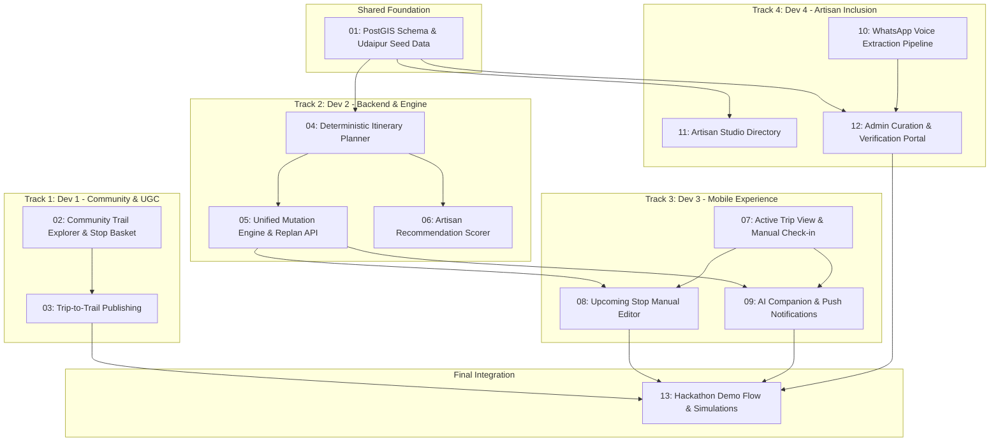

# Spec: TrailWeave 48-Hour Hackathon MVP

## Overview
This specification defines the complete Minimum Viable Product (MVP) for **TrailWeave** at the Aravalli Build Championship: Road to DevFest Udaipur. The implementation enables community-powered travel discovery, constraint-aware deterministic planning, an active in-trip companion with smart geofencing and two-way mutation (manual + AI), trip-to-trail publishing, and WhatsApp-based artisan voice onboarding.

Authoritative documentation:
- **Product Requirements**: `docs/PRD.md` (PRD v3.0)
- **Technical Architecture**: `docs/ARCHITECTURE.md`
- **Database Schema**: `docs/DATABASE_SCHEMA.md`
- **API & Tool Contracts**: `docs/API_SPEC.md`
- **Ubiquitous Domain Glossary**: `GLOSSARY.md`

## Parallel Workstreams (4 Developers)

To maximize velocity and avoid integration bottlenecks, the project is structured into 4 parallel tracks coordinated via pre-agreed API contracts in `docs/API_SPEC.md`:

- **Track 1 (Dev 1 - Community & UGC)**: Tickets 02, 03
- **Track 2 (Dev 2 - Backend & Engine)**: Tickets 01, 04, 05, 06
- **Track 3 (Dev 3 - Mobile Experience)**: Tickets 07, 08, 09
- **Track 4 (Dev 4 - Artisan Inclusion)**: Tickets 10, 11, 12
- **Track 5 (All 4 Devs - Integration)**: Ticket 13

*Note*: Tickets **01**, **02**, **07**, and **10** start immediately at hour zero using mock fixtures conforming to `docs/API_SPEC.md`.

## Issues in this feature

1. `01-foundation-postgis-schema-seed.md`: Project Foundation, Core PostGIS Schema & Udaipur Seed Data
2. `02-community-trail-explorer-stop-basket.md`: Community Trail Explorer & Stop Basket
3. `03-trip-to-trail-publishing.md`: Trip-to-Trail Contribution & Privacy-Aware Publishing
4. `04-deterministic-itinerary-planner.md`: Deterministic Itinerary Planner & Relative Duration Solver
5. `05-unified-mutation-engine-replan-api.md`: Unified Mutation Engine & Revision-Locked Replan API
6. `06-artisan-smart-recommendation-scorer.md`: TrailWeave Artisan Smart Recommendation Scorer
7. `07-active-trip-view-manual-checkin.md`: Active Trip Operational View & Manual Check-in Fallback
8. `08-upcoming-stop-manual-editor.md`: Upcoming Stop Manual Editor (View / Edit Mode)
9. `09-ai-companion-push-notifications.md`: AI Travel Companion & Web Push Transition Notifications
10. `10-whatsapp-voice-extraction-pipeline.md`: WhatsApp Webhook & Hindi Voice Note Extraction Pipeline
11. `11-artisan-studio-directory.md`: Dedicated Artisan Studio Directory (`/artisans`)
12. `12-admin-curation-verification-portal.md`: Admin Curation & Place Verification Portal (`/admin`)
13. `13-hackathon-demo-flow-simulations.md`: End-to-End Hackathon Demo Flow & Simulated Signals Verification
