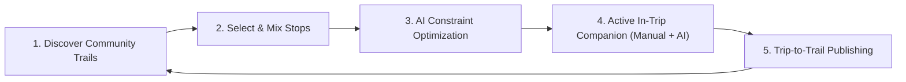

# TrailWeave

> **"Explore like a local. Travel your way. Pass it on."**  
> Community-Powered Travel Discovery | Active In-Trip Companion | Constraint-Aware AI Journeys | Inclusive Local Tourism

---

## Overview

**TrailWeave** is an intelligent, community-powered travel platform pilot-built for **Udaipur, Rajasthan, India** for the **Aravalli Build Championship: Road to DevFest Udaipur** (31 October – 1 November 2026).

Unlike traditional generic itinerary generators or influencer-dominated travel guides, TrailWeave eliminates the cold-start creator problem through a self-sustaining **Community Knowledge Loop**:



1. **Discover**: Tourists explore authentic, completed itineraries published by real travelers and locals.
2. **Select & Mix**: Tourists adopt a complete trail or hand-pick individual stops into a personal Trip Basket.
3. **Personalize**: A deterministic engine optimizes the schedule under strict budget, time window, and operating hour constraints.
4. **Active In-Trip Companion**: Travelers navigate live with smart geofencing, receive culturally rich Web Push guidance, and adapt their day on-the-fly—either manually (drag & drop) or via natural language with the Gemini AI companion. Both interfaces call the **same authoritative backend engine**.
5. **Share (Trip-to-Trail)**: At the end of the trip, travelers confirm which places they visited and publish their real journey as a community trail for future tourists to clone or adapt.
6. **Artisan Inclusion & Self-Service Catalogue**: Local craftsmen (miniature painters, terracotta potters, textile weavers) onboard directly via the **Hindi Web Voice Onboarding & Catalogue Portal (`/artisans/onboard`)** with a UPI-style 4-digit PIN, upload photos of their work/artifacts, and offer tourists both retail visits and hands-on workshops.

---

## 📚 Project Documentation Hub

All project specifications and design documents are organized according to industry standards under [`docs/`](docs/):

| Document | Description |
| :--- | :--- |
| **[`docs/PRD.md`](docs/PRD.md)** | **The Single Authoritative PRD (v3.0)**. Product vision, personas, 3-tier RBAC (`tourist`, `artisan`, `admin`), scope (P0/P1/P2), user journeys, functional requirements, and 48-hour demo script. |
| **[`docs/ARCHITECTURE.md`](docs/ARCHITECTURE.md)** | **System Architecture & Technical Design**. System topology, unified mutation engine, single source of truth (PostgreSQL revision locking), smart geofencing state machine, and deterministic vs LLM boundaries. |
| **[`docs/DATABASE_SCHEMA.md`](docs/DATABASE_SCHEMA.md)** | **Database & PostGIS Schema**. Full SQL DDL for all 10 tables, spatial indices (`GIST`), triggers, ER diagram, and multi-day relative duration modeling. |
| **[`docs/API_SPEC.md`](docs/API_SPEC.md)** | **API Specifications & Gemini Tool Contracts**. REST API endpoint tables, payload contracts, optimistic concurrency error handling (`HTTP 409`), and native Gemini function calling schemas. |
| **[`GLOSSARY.md`](GLOSSARY.md)** | **Ubiquitous Domain Terminology**. Canonical definitions for `Place`, `CommunityCuratedTrail`, `Artisan`, `TripRevision`, `ReplanProposal`, etc. Enforced across all code. |
| **[`docs/adr/`](docs/adr/)** | **Architecture Decision Records**. Immutable records of architectural choices: <br/> • [ADR 0001: Mobile PWA & FastAPI Stack](docs/adr/0001-trailweave-architecture.md)<br/> • [ADR 0002: Pivot to User-Curated Trails](docs/adr/0002-pivot-to-user-curated-itineraries.md)<br/> • [ADR 0003: Multi-Day Relative Duration Model](docs/adr/0003-multiday-relative-duration-model.md)<br/> • [ADR 0004: AI Companion & Smart Geofencing](docs/adr/0004-ai-travel-companion-and-smart-geofencing.md)<br/> • [ADR 0005: Unified Trip Engine & Concurrency](docs/adr/0005-unified-trip-engine-and-active-companion.md)<br/> • [ADR 0006: Dual Artisan Offerings & Preferences](docs/adr/0006-artisan-workshop-offerings-and-tourist-preferences.md)<br/> • [ADR 0007: Deterministic Itinerary Planner](docs/adr/0007-deterministic-itinerary-planner-and-transit-routing.md)<br/> • [ADR 0008: Unified Mutation Engine](docs/adr/0008-unified-mutation-engine-and-replan-lifecycle.md)<br/> • [ADR 0009: Artisan Smart Recommendation Scorer](docs/adr/0009-artisan-smart-recommendation-scorer-and-detour-engine.md)<br/> • [ADR 0010: Hindi Web Voice Onboarding & Catalogue](docs/adr/0010-web-voice-artisan-onboarding-and-catalogue.md)<br/> • [ADR 0011: Role Gateway, Tourist Auth & Admin Management](docs/adr/0011-role-gateway-tourist-auth-and-admin-management.md) |
| **[`docs/tickets/`](docs/tickets/README.md)** | **Hackathon Execution Board & Tickets**. 13 vertical-slice tickets organized into 4 parallel developer tracks for the 48-hour build. |
| **[`docs/tickets/backlog-gaps/`](docs/tickets/backlog-gaps/spec.md)** | **Operational Gaps & Edge Cases Backlog**. Tracks 6 open design questions (workshop capacity, in-transit delays, publishing moderation, Old City vehicle bans, multi-day night transitions, haveli offline caching). |
| **[`docs/archive/`](docs/archive/)** | **Archived Historical Briefs**. Preserves earlier revision briefs (`flows.md`, `FairPath_Changes_Since_Trip_to_Trail_Spec.md`) for provenance. |

---

## 🛠 Technology Stack

| Layer | Technologies |
| :--- | :--- |
| **Frontend PWA** | Next.js 15 (App Router), React 19, Tailwind CSS, Lucide Icons, Service Worker (Web Push) |
| **Backend API** | Python 3.11+, FastAPI, Pydantic v2, Uvicorn |
| **Database & GIS** | Supabase Managed PostgreSQL with PostGIS extension (Spatial Indexes, Point geometries) |
| **AI & LLM** | Google GenAI SDK (Gemini Flash), Native Function / Tool Calling |
| **Multi-Modal Transit** | Google Routes API v2, Distance Matrix & Deterministic Udaipur Transit Engine (`walking`, `auto_rickshaw`, `cab`) |
| **Artisan Onboarding & Catalogue** | Hindi Web Voice Recorder (`/artisans/onboard`), 4-Digit PIN Auth & Self-Service Artifact Photo Gallery |
| **Navigation** | Google Maps Platform deep-linking & Directions |

---

## 🚀 Hackathon Core Demo Scenario (3–4 Minutes)

1. **User A (Trip-to-Trail)**: Finishes an Udaipur trip, reviews actual visited stops, and publishes *"Udaipur Heritage & Miniature Art Walk"*.
2. **User B (Discover & Mix)**: Filters community trails under ₹1,500, picks stops across two trails into their Trip Basket, selects transit mode (`walking`, `auto_rickshaw`, or `cab`), and personalizes start time from their hotel.
3. **TrailWeave Recommendation**: System validates opening hours and budget, inserting *Master Mohanlal Miniature Painting Studio* (₹250 workshop fee).
4. **Active Trip Execution**: User B navigates live. Demonstrates proximity geofencing + 1-tap **Manual Check-in Fallback** in Old City alleys, dynamic transit timing connectors, plus 20-min grace buffer auto-checkout and Gemini Web Push guidance.
5. **Two-Way Mid-Trip Adaptation**:
   - **Manual Edit**: User skips an upcoming stop in Edit Mode $\rightarrow$ Proposal preview $\rightarrow$ Commits (Revision 1 $\rightarrow$ 2).
   - **AI Alteration**: User asks Gemini *"I skipped the haveli, find a quiet lakeside pottery studio under ₹200"* $\rightarrow$ Gemini reads latest Revision 2, calls tools, and presents proposal $\rightarrow$ Commits (Revision 2 $\rightarrow$ 3).
6. **Artisan Hindi Voice Onboarding & Admin Curation**: Local artisan switches to `कारीगर / Artisan` mode $\rightarrow$ records Hindi voice note + sets 4-digit PIN + uploads craft photos $\rightarrow$ Gemini English Admin Brief $\rightarrow$ Admin calls artisan via 1-tap `tel:` if needed and 1-tap approves to live directory.

---

## 📋 Getting Started

### Prerequisites
- Node.js 20+ & npm / pnpm
- Python 3.11+ & poetry / pip
- Supabase account with PostGIS enabled
- Google Gemini API key

### Repository Layout
```
.
├── README.md                          # Project overview & documentation index
├── GLOSSARY.md                        # Ubiquitous domain terminology
├── AGENTS.md                          # Agent workflows & conventions
├── docs/
│   ├── PRD.md                         # Single Authoritative Product Requirements Document
│   ├── ARCHITECTURE.md                # System Architecture & Unified Mutation Engine
│   ├── DATABASE_SCHEMA.md             # PostgreSQL + PostGIS Schema & ER Model
│   ├── API_SPEC.md                    # REST APIs & Gemini Function Calling Specs
│   ├── adr/                           # Architecture Decision Records (0001–0011)
│   ├── agents/                        # Domain docs and triage guidelines
│   ├── archive/                       # Archived historical briefs
│   └── tickets/                       # 13 vertical-slice tickets across 4 developer tracks
└── skills-lock.json                   # Agent skills lockfile
```
