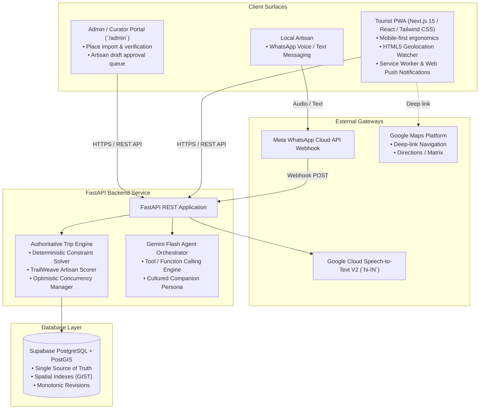
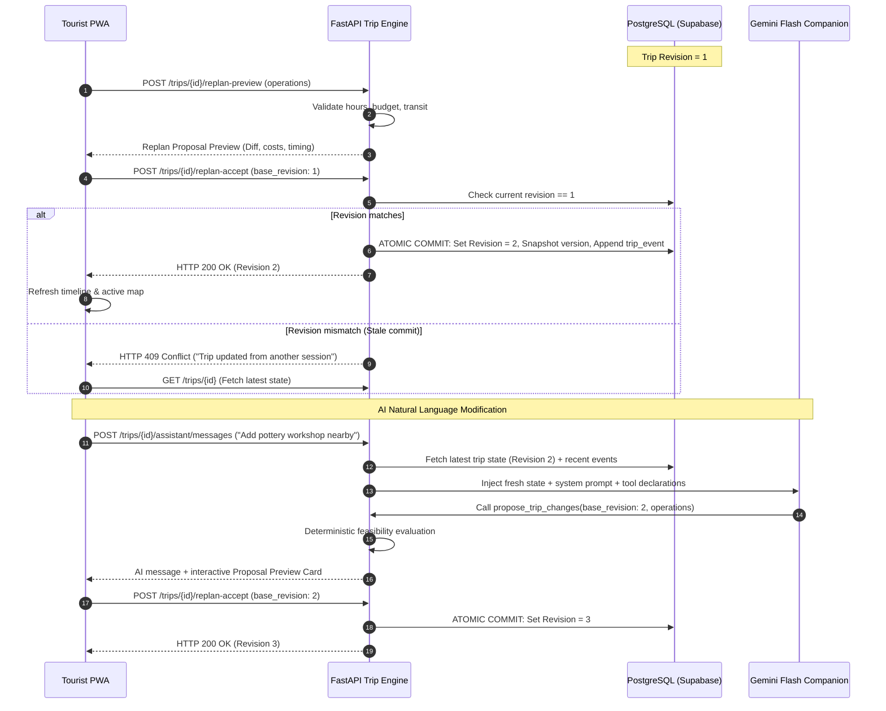
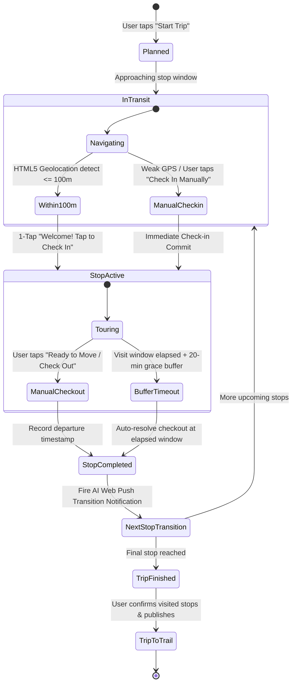

# TrailWeave: System Architecture & Technical Design

**Status:** Authoritative Technical Specification  
**Pilot Destination:** Udaipur, Rajasthan, India  
**Target Event:** Aravalli Build Championship: Road to DevFest Udaipur  
**Related ADRs:** [ADR 0001](adr/0001-trailweave-architecture.md), [ADR 0004](adr/0004-ai-travel-companion-and-smart-geofencing.md), [ADR 0005](adr/0005-unified-trip-engine-and-active-companion.md), [ADR 0006](adr/0006-artisan-workshop-offerings-and-tourist-preferences.md)

---

## 1. System Topology & Technology Stack

TrailWeave uses a decoupled, mobile-first architecture designed for zero-install tourist accessibility, deterministic scheduling accuracy, and live in-trip AI accompaniment:



### Component Stack Summary
- **Frontend**: Next.js (App Router), React, Tailwind CSS, Lucide icons, HTML5 Geolocation API, Web Push Service Worker.
- **Backend**: Python 3.11+, FastAPI, Pydantic v2, Google GenAI SDK.
- **Database**: Supabase PostgreSQL with PostGIS extension for geospatial operations and spatial indexing.
- **Speech & AI**: Google Cloud STT V2 (`hi-IN`), Gemini 1.5/2.0 Flash for structured extraction and conversational tool calling.
- **Messaging Gateway**: Meta WhatsApp Cloud API webhooks.

---

## 2. Single Authoritative Source of Truth & Concurrency Control

Neither React local state nor LLM conversational context is canonical. **PostgreSQL holds the sole authoritative accepted state** of an itinerary.



### Optimistic Concurrency Mechanics
1. **Revision Property**: The `trips` table maintains a strictly monotonic integer `revision` (starts at 1).
2. **Proposals**: Any modification (manual drag-and-drop or AI tool execution) generates a provisional `replan_proposals` record bound to a specific `base_revision`.
3. **Commit Guard**: When accepting a proposal, the client must supply `expected_revision`. If `expected_revision != trips.revision`, the transaction aborts immediately and returns **HTTP 409 Conflict**.
4. **Append-Only Event Log**: Every committed modification generates a record in `trip_events` (`actor`, `source`, `event_type`, `payload`), enabling the AI to know what recently happened.

---

## 3. Unified Mutation Architecture

Both direct manual user actions and natural-language AI requests route through the **exact same deterministic trip engine**:

```mermaid
graph TD
    subgraph Client [Tourist Mobile PWA]
        ManualUI["Manual Edit Mode<br/>• Drag & reorder stops<br/>• 1-tap Skip / Remove<br/>• Pin stop"]
        ChatUI["Gemini Chat Assistant<br/>• 'I'm tired, make it shorter'<br/>• 'Find a pottery workshop under ₹300'"]
    end

    subgraph BackendEngine [FastAPI Shared Trip Engine]
        ToolRouter["Gemini Tool Calling / API Router"]
        ConstraintSolver["Deterministic Constraint Solver<br/>• Opening/Closing hours check<br/>• Transit time matrix calculation<br/>• Hard budget limit validation"]
        TrailWeaveScorer["TrailWeave Artisan Scorer<br/>• Proximity & detour minimization<br/>• Workshop vs Store preference match<br/>• Budget headroom validation"]
        ProposalEngine["Proposal Generator & Diff Service<br/>• Before/After cost comparison<br/>• Duration impact calculation"]
    end

    subgraph DB [Supabase PostgreSQL]
        TripsTable[("trips (Authoritative Revision N)")]
        VersionsTable[("itinerary_versions (Immutable Snapshots)")]
        EventsTable[("trip_events (Append-Only Audit)")]
        ProposalsTable[("replan_proposals (Provisional)")]
    end

    ManualUI -->|POST /replan-preview| BackendEngine
    ChatUI -->|POST /assistant/messages| ToolRouter
    ToolRouter -->|propose_trip_changes| BackendEngine
    BackendEngine --> ConstraintSolver
    BackendEngine --> TrailWeaveScorer
    BackendEngine --> ProposalEngine
    ProposalEngine --> ProposalsTable
    ProposalEngine -->> Client: Return Proposal Preview (Diff, Times, Costs)
    Client -->|POST /replan-accept (expected_revision)| BackendEngine
    BackendEngine -->|Atomic Transaction: Revision N+1| TripsTable
    BackendEngine -->|Store Snapshot| VersionsTable
    BackendEngine -->|Append Event| EventsTable
    TripsTable -->> Client: UI Timeline, Map & AI Context Refresh
```

---

## 4. Smart Geofencing & Lifecycle State Machine

To provide an intelligent in-trip companion without frustrating battery drain or GPS drift issues in Udaipur's historic old city, TrailWeave implements a hybrid geofencing model:



### Geofencing Safeguards
1. **100-Meter Geofence Proximity**: Detected via browser `navigator.geolocation.watchPosition`. Triggers an in-app banner: *"Welcome to Jagdish Temple! Tap to check in."*
2. **Prominent 1-Tap Manual Check-in Fallback**: Narrow alleys in Jagdish Chowk or Gangaur Ghat often degrade GPS reception. Every stop card features a 1-tap **"Check In Manually"** button that requires zero satellite lock.
3. **20-Minute Missed Checkout Grace Buffer**: If a traveler gets immersed in City Palace and forgets to tap checkout, the system automatically resolves the checkout 20 minutes after the planned duration elapses, updates the remaining timeline, and guides the user forward.
4. **Transition Notifications**: Sent via Service Worker Web Push to lock screens:
   > *"Right on time, Raghav! Up next is City Palace. Enter via Badi Pol gate—it's cooler on the lake-facing pavilions right now. Stroll down via Gangaur Ghat."*

---

## 5. Division of Responsibilities: Deterministic Engine vs LLM

TrailWeave enforces a strict boundary between mathematical computation and natural language generation:

| Capability | Deterministic Backend (Python / PostGIS) | LLM (Gemini Flash) |
| :--- | :--- | :--- |
| **Geographic Distances & Transit Times** | Haversine / PostGIS `ST_Distance` / Transit Matrix. | Never computes transit numbers. |
| **Opening / Closing Hours Feasibility** | Hard boolean check against venue timetable. | Never hallucinates open hours. |
| **Budget & Expense Calculations** | Strict mathematical sum (`entry_fee + workshop_fee`). | Expresses costs in conversational summaries. |
| **Itinerary Commit & Database Write** | Authorized FastAPI transaction with revision check. | Proposes candidates via typed tools only; cannot execute SQL. |
| **Persona & Cultural Tone** | Supplies structured context (tourist name, preferences, stops). | Crafts warm, elegant, "Cultured Local Friend" narrative guidance. |
| **Voice Note Structured Extraction** | Receives audio stream and runs STT transcription. | Extracts structured JSON schema from Hindi/Mewari transcripts. |
