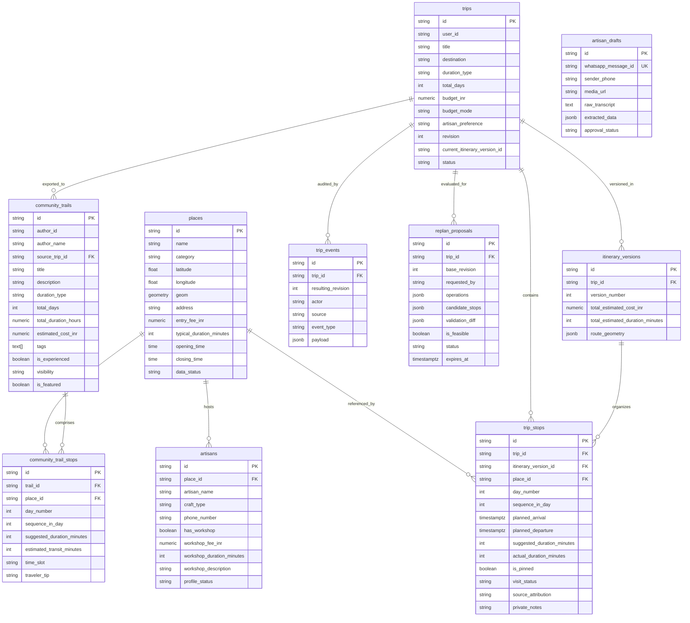

# TrailWeave: Database Schema & Entity Relationship Specification

**Status:** Authoritative Database Specification  
**Engine:** PostgreSQL 15+ with PostGIS Extension (Supabase Managed)  
**Related ADRs:** [ADR 0001](adr/0001-trailweave-architecture.md), [ADR 0003](adr/0003-multiday-relative-duration-model.md), [ADR 0005](adr/0005-unified-trip-engine-and-active-companion.md), [ADR 0006](adr/0006-artisan-workshop-offerings-and-tourist-preferences.md)

---

## 1. Entity-Relationship (ER) Overview



---

## 2. Complete SQL Schema & Spatial Setup

```sql
-- Enable PostGIS extension for geospatial radius and distance calculations
CREATE EXTENSION IF NOT EXISTS postgis;

-- ============================================================================
-- 1. Canonical Places
-- Verified physical points of interest, heritage monuments, dining, and craft studios
-- ============================================================================
CREATE TABLE places (
    id TEXT PRIMARY KEY,
    name TEXT NOT NULL,
    category TEXT NOT NULL, -- 'attraction', 'heritage', 'dining', 'artisan_studio'
    latitude DOUBLE PRECISION NOT NULL,
    longitude DOUBLE PRECISION NOT NULL,
    geom GEOMETRY(Point, 4326),
    address TEXT NOT NULL,
    entry_fee_inr NUMERIC DEFAULT 0,
    typical_duration_minutes INT DEFAULT 45,
    opening_time TIME,
    closing_time TIME,
    data_status TEXT DEFAULT 'verified', -- 'verified', 'reported', 'estimated', 'demo_simulated'
    created_at TIMESTAMPTZ DEFAULT NOW()
);

-- Spatial index for radius and proximity queries
CREATE INDEX idx_places_geom ON places USING GIST (geom);
CREATE INDEX idx_places_category ON places (category);

-- Trigger to automatically populate geom from lat/lng if not explicitly passed
CREATE OR REPLACE FUNCTION update_places_geom()
RETURNS TRIGGER AS $$
BEGIN
    NEW.geom = ST_SetSRID(ST_MakePoint(NEW.longitude, NEW.latitude), 4326);
    RETURN NEW;
END;
$$ LANGUAGE plpgsql;

CREATE TRIGGER trg_places_geom_update
BEFORE INSERT OR UPDATE OF latitude, longitude ON places
FOR EACH ROW EXECUTE FUNCTION update_places_geom();

-- ============================================================================
-- 2. Artisans (Linked 1:1 or 1:N with Canonical Places)
-- Local craftsmen profile, store hours, and hands-on workshop pricing
-- ============================================================================
CREATE TABLE artisans (
    id TEXT PRIMARY KEY,
    place_id TEXT REFERENCES places(id) ON DELETE CASCADE,
    artisan_name TEXT NOT NULL,
    craft_type TEXT NOT NULL, -- e.g. 'Miniature Painting', 'Terracotta Pottery', 'Pichwai Art'
    phone_number TEXT,
    bio TEXT,
    has_workshop BOOLEAN DEFAULT FALSE,
    workshop_fee_inr NUMERIC DEFAULT 0,
    workshop_duration_minutes INT DEFAULT 45,
    workshop_description TEXT,
    profile_status TEXT DEFAULT 'approved', -- 'approved', 'pending_review', 'rejected'
    created_at TIMESTAMPTZ DEFAULT NOW()
);

CREATE INDEX idx_artisans_place_id ON artisans (place_id);
CREATE INDEX idx_artisans_has_workshop ON artisans (has_workshop);

-- ============================================================================
-- 3. Authoritative Trips (Private in 'My Trips')
-- Monotonically increasing revision counter manages optimistic concurrency
-- ============================================================================
CREATE TABLE trips (
    id TEXT PRIMARY KEY,
    user_id TEXT NOT NULL,
    title TEXT,
    destination TEXT DEFAULT 'Udaipur',
    duration_type TEXT DEFAULT 'single_day', -- 'single_day', 'multi_day'
    total_days INT DEFAULT 1,
    budget_inr NUMERIC NOT NULL,
    budget_mode TEXT DEFAULT 'total', -- 'total', 'per_day'
    artisan_preference TEXT DEFAULT 'both', -- 'workshop', 'store', 'both', 'none'
    revision INT NOT NULL DEFAULT 1, -- Monotonic integer: increments on every accepted replan/mutation
    current_itinerary_version_id TEXT,
    status TEXT DEFAULT 'planned', -- 'planned', 'in_progress', 'completed'
    completed_at TIMESTAMPTZ,
    updated_at TIMESTAMPTZ DEFAULT NOW(),
    created_at TIMESTAMPTZ DEFAULT NOW()
);

CREATE INDEX idx_trips_user_id ON trips (user_id);
CREATE INDEX idx_trips_revision ON trips (id, revision);

-- ============================================================================
-- 4. Immutable Itinerary Version Snapshots
-- Snapshot preserved upon each accepted proposal commit
-- ============================================================================
CREATE TABLE itinerary_versions (
    id TEXT PRIMARY KEY,
    trip_id TEXT REFERENCES trips(id) ON DELETE CASCADE,
    version_number INT NOT NULL,
    total_estimated_cost_inr NUMERIC NOT NULL,
    total_estimated_duration_minutes INT NOT NULL,
    route_geometry JSONB, -- Polyline / transit summary
    created_at TIMESTAMPTZ DEFAULT NOW()
);

CREATE INDEX idx_itinerary_versions_trip_id ON itinerary_versions (trip_id, version_number);

-- ============================================================================
-- 5. Trip Stops (Active Execution & Realized Durations)
-- ============================================================================
CREATE TABLE trip_stops (
    id TEXT PRIMARY KEY,
    trip_id TEXT REFERENCES trips(id) ON DELETE CASCADE,
    itinerary_version_id TEXT REFERENCES itinerary_versions(id) ON DELETE CASCADE,
    place_id TEXT REFERENCES places(id),
    day_number INT DEFAULT 1,
    sequence_in_day INT NOT NULL,
    planned_arrival TIMESTAMPTZ,
    planned_departure TIMESTAMPTZ,
    suggested_duration_minutes INT NOT NULL,
    actual_duration_minutes INT,
    is_pinned BOOLEAN DEFAULT FALSE,
    visit_status TEXT DEFAULT 'pending', -- 'pending', 'visited', 'skipped'
    source_attribution TEXT,
    private_notes TEXT
);

CREATE INDEX idx_trip_stops_trip_id ON trip_stops (trip_id);
CREATE INDEX idx_trip_stops_visit_status ON trip_stops (visit_status);

-- ============================================================================
-- 6. Append-Only Trip Event Log
-- Audit history powering AI context awareness of recent manual edits
-- ============================================================================
CREATE TABLE trip_events (
    id TEXT PRIMARY KEY,
    trip_id TEXT REFERENCES trips(id) ON DELETE CASCADE,
    resulting_revision INT NOT NULL,
    actor TEXT NOT NULL, -- 'user', 'ai_assistant', 'system'
    source TEXT NOT NULL, -- 'manual_editor', 'ai_tool', 'geofence', 'buffer_timeout'
    event_type TEXT NOT NULL, -- 'stop_visited', 'stop_skipped', 'stops_reordered', 'replan_committed'
    payload JSONB,
    created_at TIMESTAMPTZ DEFAULT NOW()
);

CREATE INDEX idx_trip_events_trip_revision ON trip_events (trip_id, resulting_revision);

-- ============================================================================
-- 7. Provisional Replan Proposals
-- Candidate itineraries validated against constraints awaiting tourist sign-off
-- ============================================================================
CREATE TABLE replan_proposals (
    id TEXT PRIMARY KEY,
    trip_id TEXT REFERENCES trips(id) ON DELETE CASCADE,
    base_revision INT NOT NULL,
    requested_by TEXT NOT NULL, -- 'manual_editor', 'ai_assistant'
    operations JSONB NOT NULL,
    candidate_stops JSONB NOT NULL,
    validation_diff JSONB NOT NULL, -- before/after costs, durations, conflicts
    is_feasible BOOLEAN NOT NULL,
    status TEXT DEFAULT 'pending', -- 'pending', 'accepted', 'rejected', 'expired'
    expires_at TIMESTAMPTZ NOT NULL,
    created_at TIMESTAMPTZ DEFAULT NOW()
);

CREATE INDEX idx_replan_proposals_trip_status ON replan_proposals (trip_id, status);

-- ============================================================================
-- 8. Community Trails (Public / Shareable Discovery)
-- ============================================================================
CREATE TABLE community_trails (
    id TEXT PRIMARY KEY,
    author_id TEXT NOT NULL,
    author_name TEXT NOT NULL,
    source_trip_id TEXT REFERENCES trips(id),
    title TEXT NOT NULL,
    description TEXT,
    destination TEXT DEFAULT 'Udaipur',
    duration_type TEXT DEFAULT 'single_day', -- 'single_day', 'multi_day'
    total_days INT DEFAULT 1,
    total_duration_hours NUMERIC,
    estimated_cost_inr NUMERIC,
    tags TEXT[],
    is_experienced BOOLEAN DEFAULT TRUE,
    visibility TEXT DEFAULT 'public', -- 'public', 'unlisted', 'private'
    is_featured BOOLEAN DEFAULT FALSE,
    created_at TIMESTAMPTZ DEFAULT NOW()
);

CREATE INDEX idx_community_trails_featured ON community_trails (is_featured, created_at DESC);
CREATE INDEX idx_community_trails_tags ON community_trails USING GIN (tags);

-- ============================================================================
-- 9. Community Trail Stops (Relative Duration Storage)
-- Uses relative durations and time slots so any tourist can clone to any calendar date
-- ============================================================================
CREATE TABLE community_trail_stops (
    id TEXT PRIMARY KEY,
    trail_id TEXT REFERENCES community_trails(id) ON DELETE CASCADE,
    place_id TEXT REFERENCES places(id),
    day_number INT DEFAULT 1,
    sequence_in_day INT NOT NULL,
    suggested_duration_minutes INT NOT NULL,
    estimated_transit_minutes INT DEFAULT 15,
    time_slot TEXT, -- 'morning', 'afternoon', 'sunset_evening', 'night'
    traveler_tip TEXT
);

CREATE INDEX idx_community_trail_stops_trail ON community_trail_stops (trail_id, day_number, sequence_in_day);

-- ============================================================================
-- 10. Artisan Voice Drafts
-- WhatsApp voice messages transcribed and extracted before admin publication
-- ============================================================================
CREATE TABLE artisan_drafts (
    id TEXT PRIMARY KEY,
    whatsapp_message_id TEXT UNIQUE,
    sender_phone TEXT NOT NULL,
    media_url TEXT,
    raw_transcript TEXT,
    extracted_data JSONB,
    approval_status TEXT DEFAULT 'draft', -- 'draft', 'pending_confirmation', 'approved', 'rejected'
    created_at TIMESTAMPTZ DEFAULT NOW()
);

CREATE INDEX idx_artisan_drafts_status ON artisan_drafts (approval_status);
```
