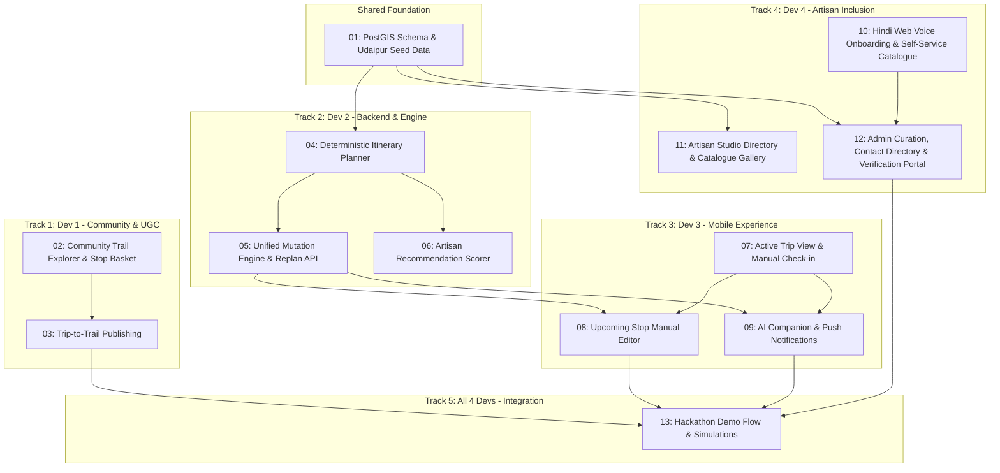

# TrailWeave MVP Tickets Directory

Welcome to the hackathon issue tracker and execution board for the TrailWeave MVP.

The project is structured into **4 parallel developer tracks** with sparse dependencies, enabling 4 developers to work concurrently with zero initial blocking by coordinating around pre-agreed API contracts in [`docs/API_SPEC.md`](../API_SPEC.md) and [`docs/DATABASE_SCHEMA.md`](../DATABASE_SCHEMA.md).

---

## Developer Allocation Matrix

| Track | Primary Focus | Assigned Dev | Starter Ticket (Hour 0) | Tickets in Track |
| :--- | :--- | :--- | :--- | :--- |
| [**Track 1: Community Discovery & UGC**](track-1-community-discovery/) | Homepage, Trail Explorer, Basket, Trip-to-Trail | **Dev 1** | [Ticket 02](track-1-community-discovery/02-community-trail-explorer-stop-basket.md) | `02`, `03` |
| [**Track 2: Trip Engine & Backend**](track-2-trip-engine-backend/) | DB Schema, Solver, Replan API, Artisan Scorer | **Dev 2** | [Ticket 01](track-2-trip-engine-backend/01-foundation-postgis-schema-seed.md) | `01`, `04`, `05`, `06` |
| [**Track 3: Active Trip Companion**](track-3-active-trip-companion/) | Active Trip UI, Manual Check-in, Edit Mode, AI Chat | **Dev 3** | [Ticket 07](track-3-active-trip-companion/07-active-trip-view-manual-checkin.md) | `07`, `08`, `09` |
| [**Track 4: Artisan Voice Onboarding, Catalogue & Admin**](track-4-artisan-onboarding-admin/) | Hindi Web Voice Onboarding (`/artisans/onboard`), 4-Digit PIN, Catalogue Photos, STT (`hi-IN`), Gemini Admin Brief, `/artisans`, `/admin` | **Dev 4** | [Ticket 10](track-4-artisan-onboarding-admin/10-hindi-web-voice-onboarding-catalogue.md) | `10`, `11`, `12` |
| [**Track 5: Integration & Demo**](track-5-integration-demo/) | End-to-End Demo Script, Concurrency & Simulations | **All 4 Devs** | Blocked by Tracks 1–4 | `13` |

---

## Dependency Graph



---

## Folder Structure

```
docs/tickets/
├── README.md                                         <-- This index
├── track-1-community-discovery/                     <-- Dev 1
│   ├── 02-community-trail-explorer-stop-basket.md
│   └── 03-trip-to-trail-publishing.md
├── track-2-trip-engine-backend/                      <-- Dev 2
│   ├── 01-foundation-postgis-schema-seed.md
│   ├── 04-deterministic-itinerary-planner.md
│   ├── 05-unified-mutation-engine-replan-api.md
│   └── 06-artisan-smart-recommendation-scorer.md
├── track-3-active-trip-companion/                    <-- Dev 3
│   ├── 07-active-trip-view-manual-checkin.md
│   ├── 08-upcoming-stop-manual-editor.md
│   └── 09-ai-companion-push-notifications.md
├── track-4-artisan-onboarding-admin/                  <-- Dev 4
│   ├── 10-hindi-web-voice-onboarding-catalogue.md
│   ├── 11-artisan-studio-directory.md
│   └── 12-admin-curation-verification-portal.md
└── track-5-integration-demo/                         <-- All 4 Devs
    └── 13-hackathon-demo-flow-simulations.md
└── backlog-gaps/                                     <-- Post-MVP / Edge-Case Log
    ├── 01-workshop-capacity-policy.md
    ├── 02-in-transit-delays-missed-checkins.md
    ├── 03-community-trail-publishing-moderation.md
    ├── 04-old-city-pedestrian-zones.md
    ├── 05-multiday-overnight-transitions.md
    └── 06-offline-caching-havelis.md
```

---

## API Contract Governance

- **Immutable Contract**: [`docs/API_SPEC.md`](../API_SPEC.md) and [`docs/DATABASE_SCHEMA.md`](../DATABASE_SCHEMA.md).
- **Backend Steward**: Dev 2 implements Pydantic models.
- **Frontend Independence**: Dev 1 and Dev 3 consume mock JSON matching `API_SPEC.md` and are never blocked waiting for backend deployments.
- **5-Minute PR Rule**: Missing field requests require a 2-line proposal to Dev 2, who merges and adjusts the schema immediately.
